# WriteWiser v47 — Modular Architecture, Task 1 Image Proxy, Fast Leaderboard & Active Recall

## Điểm mới ở bản v47
- **Kiến trúc Backend Modular (`server.py`, `ww_db.py`, `ww_ai.py`, `ww_importer.py`, `ww_scoring.py`):** Tách biệt rõ ràng tầng cơ sở dữ liệu, cổng AI đa nhà cung cấp, bộ công cụ nhập đề (DOCX/HTML/CSV/JSON/DOL) và bộ chấm điểm IELTS 4 tiêu chí. Vẫn giữ nguyên lệnh khởi chạy `python server.py`.
- **Khắc phục triệt để lỗi CORS mất ảnh biểu đồ Task 1:** Bổ sung `GET /api/image-proxy` (chỉ cho phép whitelist domain của DOL) và cơ chế tự động tải ảnh biểu đồ ở phía máy chủ (`fetch_task1_image_as_data_url`) khi trình duyệt không thể đọc canvas trực tiếp từ CDN ngoài.
- **Tối ưu hóa Database & `/api/dashboard`:**
  - Tái sử dụng kết nối PostgreSQL theo luồng (`Thread-Local Connection Pooling`) trong `PostgresSession`, loại bỏ việc phải bắt tay TCP+SSL 2–4 lần trên mỗi HTTP request.
  - Bổ sung cột chỉ mục `task` và `overall_band` vào bảng `user_history` cùng bộ nhớ đệm Leaderboard trong RAM (TTL 60 giây), không còn quét toàn bảng `user_state` trên mỗi lượt mở Dashboard.
  - Tự động dọn dẹp các phiên đăng nhập và phiên cổng mật khẩu đã hết hạn (`maybe_prune_expired_sessions`).
- **Tăng cường bảo mật Static File Handler:** Vô hiệu hóa `list_directory` (không cho phép duyệt thư mục `/assets/`) và chuẩn hóa đường dẫn bằng `posixpath.normpath` trước khi kiểm tra danh sách chặn.
- **Nâng cấp Học thuật & Phân tích (Pedagogy & Analytics):**
  - **Biểu đồ Xu hướng Overall Band theo thời gian (Time-Series Trend Chart)** trong Dashboard.
  - **Chế độ Ôn tập Flashcard (Spaced Repetition / Active Recall)** ngay trong trang *Sổ tay ghi chú AI*.
  - **Chế độ Luyện sửa lỗi nhanh (Active Error Recall Quiz)** ngay trong trang *Sổ tay lỗi sai*.
- **Cập nhật `migrate_sqlite_to_postgres.py`:** Hỗ trợ đồng bộ đầy đủ cả 12 bảng của kiến trúc v47.

## Sơ đồ Kiến trúc Hệ thống (WriteWiser v47)

```mermaid
flowchart TB
    Learner((Learner / Admin))

    subgraph SecurityGate["1. Access & Security Layer"]
        GateUI["Access Gate UI<br/>[index.html / app.js]"]
        GateAuth["Gate & Session Auth + Session Pruner<br/>[server.py / ww_db.py]"]
    end

    subgraph Frontend["2. Frontend SPA Workspace [index.html + app.js]"]
        LibUI["Lesson Library & Importer<br/>(DOL Excerpts, DOCX/CSV/JSON)"]
        RevUI["Reverse Translation Mode<br/>(Sentence-by-Sentence + Hints)"]
        IndUI["Independent Writing Mode<br/>(Task 1 & 2 + Practice/Exam Timer)"]
        BrainUI["Mindmap Brainstorm<br/>(Idea + Explain 1 + Example/Explain2/Result)"]
        NotesUI["AI Notebook & Error Log<br/>(+ Flashcard & Active Recall Quiz)"]
        DashUI["History, SVG Dashboard & Leaderboard<br/>(+ Time-Series Band Trend Chart)"]
        CalibUI["Rubric & Calibration Lab<br/>[calibration.html]"]
    end

    subgraph Backend["3. Modular Backend API & AI Orchestration"]
        Router["ThreadingHTTPServer + SEO Router<br/>[server.py]"]
        ImporterSvc["Import & NLP Service<br/>[ww_importer.py + /api/segment-paragraphs]"]
        BrainSvc["Brainstorm Reviewer<br/>[/api/brainstorm-review]"]
        TransSvc["Translation Reviewer<br/>[/api/feedback & /api/translation-sentence-feedback]"]
        EssaySvc["IELTS 4-Criteria Assessor + Image Proxy<br/>[ww_scoring.py + /api/writing-feedback]"]
        NoteSvc["AI Note Generator<br/>[/api/notes/generate]"]
        AIGateway["Multi-Provider AI Gateway + JSON Healing<br/>[ww_ai.py: Gemini → Groq → Together → OpenRouter]"]
    end

    subgraph Storage["4. Persistence Layer [ww_db.py]"]
        LocalStore[("Browser LocalStorage<br/>(Guest Cache & Offline Drafts)")]
        DBAdapter["Thread-Local Pooled DB Adapter<br/>[SQLiteSession WAL / PostgresSession]"]
        Postgres[("PostgreSQL (Supabase)<br/>12 Tables + Indexed Leaderboard")]
        SQLite[("SQLite Local<br/>draftwise.sqlite3")]
    end

    Learner --> GateUI --> GateAuth
    Learner --> LibUI & RevUI & IndUI & BrainUI & NotesUI & DashUI & CalibUI

    LibUI -->|Import / Segment / Translate| ImporterSvc
    RevUI -->|Check Sentence / Full Submit| TransSvc
    IndUI -->|Submit Essay + Task 1 Chart URL/Data| EssaySvc
    BrainUI -->|Submit Mindmap| BrainSvc
    NotesUI -->|Generate Note| NoteSvc
    DashUI & CalibUI -->|Sync State, History & Calibrations| Router

    RevUI & IndUI & BrainUI & NotesUI <-->|Auto-save / Guest Fallback| LocalStore

    ImporterSvc & BrainSvc & TransSvc & EssaySvc & NoteSvc --> AIGateway
    GateAuth & Router & EssaySvc & NoteSvc & TransSvc --> DBAdapter
    DBAdapter -->|DATABASE_URL set| Postgres
    DBAdapter -->|Fallback locally| SQLite
```



---

# WriteWiser v46 — Note Excerpts & Toggleable Manual Creation

- Lịch sử AI review khôi phục `question`, `task`, `lessonTitle` và bài nộp từ snapshot của lượt làm, không dùng nhầm đề đang mở trong thư viện. Kết quả cũ hiển thị snapshot đề/bài đã chấm; vùng bài viết ở chế độ xem lại là chỉ đọc.
- Prompt AI ở chế độ Tự viết yêu cầu một JSON contract thống nhất, đủ 4 tiêu chí và điểm breakdown nguyên 0–9; Overall Band do server tính từ bốn tiêu chí và làm tròn nửa band.
- `vocabulary_review` và `grammar_review` tạo bảng sửa lỗi riêng khi có bằng chứng phù hợp; các trường này là tùy chọn. `paragraph_feedback`, `upgraded_version`, `next_steps` và `additional_notes` cũng có thể rỗng nếu không phù hợp với bài cụ thể.
- Server chuẩn hóa các tên trường thay thế phổ biến từ AI provider trước khi lưu/hiển thị kết quả.

## v38 — Sổ tay ghi chú AI
- Bôi đen một từ, cụm từ, mệnh đề/vế câu hoặc câu trong vùng làm bài rồi nhấn **Lưu đoạn bôi đen** để AI tạo ghi chú tiếng Việt gồm điểm cần nhớ, nghĩa theo ngữ cảnh, cách dùng/cấu trúc/collocation và ví dụ Anh–Việt.
- Trang riêng `/so-tay-ghi-chu-ai` hỗ trợ tìm kiếm, lọc loại ghi chú, sao chép và xóa. Ghi chú của tài khoản được lưu tách biệt trong bảng `user_notes` trên PostgreSQL; khách chưa đăng nhập dùng localStorage của trình duyệt hiện tại.
- Dùng lại cấu hình AI provider hiện có qua `AI_PROVIDER_ORDER` và `CUSTOM_AI_PROVIDERS_JSON`; không cần tạo API key riêng cho ghi chú. Endpoint `/api/notes/generate` có giới hạn tốc độ cơ bản giống các endpoint AI khác.
- Backend tự tạo bảng `user_notes` khi khởi động; không cần chạy migration thủ công. `/api/health` báo phiên bản `38-ai-notes`.

## v37 — Lịch sử lưu riêng, không bị ghi đè bởi bản nháp
- Lịch sử các lượt luyện được tách khỏi JSON trạng thái tài khoản sang bảng `user_history`, có khóa theo tài khoản và ID lượt làm. Lưu/cập nhật bản nháp không còn ghi đè hoặc xóa lịch sử.
- Bản ghi được gửi lên máy chủ ngay sau khi nộp, sau khi có phản hồi AI thì cập nhật lại bản ghi đó. Lịch sử không còn bị giới hạn 100 lượt ở phía tài khoản; 100 lượt gần nhất chỉ là cache cục bộ trên trình duyệt.
- Khi đọc lịch sử lần đầu, backend tự chuyển lịch sử cũ trong `user_state` sang bảng mới. Lịch sử khách chưa đăng nhập được nhập vào tài khoản khi đăng nhập/đăng ký trên cùng trình duyệt.
- Xóa một lượt/xóa toàn bộ gọi API riêng và chỉ xóa dữ liệu lịch sử, không bị bản nháp đồng bộ tạo lại. Dashboard và bảng xếp hạng cũng đọc từ bảng lịch sử mới.
- Muốn lịch sử tồn tại qua lần khởi động lại/redeploy trên Render, phải cấu hình `DATABASE_URL` tới PostgreSQL bền vững (theo phần triển khai bên dưới). Nếu `/api/health` báo `database: sqlite-local` trên hosting có filesystem tạm thời, dữ liệu server vẫn có thể mất khi instance bị thay thế. Khi chưa đăng nhập, dữ liệu chỉ nằm trong bộ nhớ lưu trữ của trình duyệt đó.

## v35 — Fix mở giao diện làm bài

- Sửa `wwSyncBrowserRoute()` sử dụng rõ `window.history.pushState()` và `window.history.replaceState()`, tránh xung đột với biến `history` lưu lịch sử bài làm.
- Bản v38 tăng cache-busting của `app.js` và `styles.css` lên `?v=38` để trình duyệt tải giao diện sổ tay ghi chú AI mới.
- Không thay đổi dữ liệu, API key, cấu hình Render hay cơ sở dữ liệu.

# WriteWiser v34 — SEO routes & Google Search Console

Bản này kế thừa ứng dụng v11 và bổ sung adapter PostgreSQL để triển khai nhiều người dùng trên hosting từ xa.


## Chia sẻ lên Facebook
- Trang chính và trang hiệu chuẩn có Open Graph/Twitter Card metadata với ảnh xem trước `assets/og-image-v30.png` (1200×630).
- Server trả URL tuyệt đối theo `PUBLIC_BASE_URL` nếu đặt biến này; nếu không, dùng host/protocol từ request/reverse proxy.
- Nếu website có tên miền riêng, nên đặt `PUBLIC_BASE_URL=https://ten-mien-cua-ban` trong Environment trên Render để metadata luôn nhất quán.
- Sau khi deploy, có thể dùng Facebook Sharing Debugger để yêu cầu Facebook đọc lại metadata sau khi thay đổi ảnh hoặc mô tả.

## Kiến trúc
- Render Free Web Service chạy Python HTTP server; `render.yaml` khai báo build/start/health check.
- Supabase Free PostgreSQL lưu users, sessions, user_state. Khi có `DATABASE_URL`, server dùng PostgreSQL; nếu không có, chạy SQLite cục bộ như trước.
- `GEMINI_API_KEY` và `DATABASE_URL` chỉ đặt trong Environment của Render, không đưa vào frontend hoặc GitHub.
- Có giới hạn tốc độ cơ bản theo IP cho đăng ký, đăng nhập và các endpoint gọi AI. Đây là lớp bảo vệ cơ bản cho single-instance free hosting, không thay thế hệ thống chống lạm dụng production.
- Secure cookie bật qua `DRAFTWISE_SECURE_COOKIE=1`.

## Triển khai miễn phí

### A. Tạo cơ sở dữ liệu Supabase
1. Vào https://supabase.com/ và tạo một project Free.
2. Lưu lại database password an toàn.
3. Mở **Connect** trong dashboard, chọn **Transaction pooler** và sao chép connection string PostgreSQL. Dùng chuỗi URI có `sslmode=require` nếu được cung cấp. Không đưa chuỗi này vào mã nguồn hoặc repo.
4. Server tự tạo bảng `users`, `sessions`, `user_state` khi khởi động lần đầu.

### B. Đưa mã nguồn lên GitHub
1. Tạo repository mới, ví dụ `draftwise`.
2. Upload các file/thư mục trong gói v13. Không upload `.env`, `draftwise.sqlite3`, API key hoặc database password.
3. Đảm bảo `render.yaml`, `requirements.txt`, `server.py`, `index.html`, `app.js`, `styles.css`, `assets/` và `resources/` nằm ở thư mục gốc repository.

### C. Deploy trên Render
1. Vào https://render.com/ và kết nối GitHub.
2. Chọn **New → Blueprint** rồi chọn repository có `render.yaml` (hoặc tạo Web Service và dùng build/start commands bên dưới).
3. Đặt các environment variables được hỏi:
   - `DATABASE_URL`: connection string Supabase Transaction pooler.
   - `GEMINI_API_KEY`: API key của bạn.
   - `GEMINI_MODEL`: `gemini-2.5-flash` (có thể đổi sang model được tài khoản/API của bạn hỗ trợ).
   - `DRAFTWISE_HOST`: `0.0.0.0`.
   - `DRAFTWISE_SECURE_COOKIE`: `1`.
   - `WRITEWISER_GATE_PASSWORD`: mật khẩu truy cập chung, nên dài ít nhất 12 ký tự.
   - `WRITEWISER_ADMIN_USERNAME`: `admin` (hoặc tên đăng nhập bạn chọn).
   - `WRITEWISER_ADMIN_PASSWORD`: mật khẩu admin, nên dài ít nhất 12 ký tự.
4. Nếu tạo Web Service thủ công:
   - Runtime: Python
   - Build command: `pip install -r requirements.txt`
   - Start command: `python server.py`
   - Health check path: `/api/health`
   - Plan: Free
5. Chờ deploy hoàn tất, mở URL `https://<ten-dich-vu>.onrender.com`, rồi kiểm tra `https://<ten-dich-vu>.onrender.com/api/health`. Trường `database` phải là `postgres`, và `aiConfigured` phải là `true`.

## Chuyển dữ liệu từ SQLite cũ (tùy chọn)
Nếu muốn giữ tài khoản/lịch sử ở file `draftwise.sqlite3` cũ:
1. Sao chép file cũ vào thư mục v13 trên máy của bạn (không commit lên GitHub).
2. Cài dependency: `pip install -r requirements.txt`.
3. Đặt biến `DATABASE_URL` thành connection string Supabase. Trên PowerShell:
   ```powershell
   $env:DATABASE_URL="postgresql://..."
   python migrate_sqlite_to_postgres.py
   ```
4. Chỉ chạy migration một lần vào database mới hoặc sau khi đã hiểu rõ dữ liệu đích. Sao lưu file SQLite trước. Script chuyển users, sessions và user_state; nó không chuyển cache/localStorage nằm riêng trong từng trình duyệt.

## Giới hạn free hosting cần biết
- Render Free có thể spin down sau 15 phút không có traffic; lần truy cập đầu sau đó có thể chậm khoảng một phút. Filesystem của Render Free là ephemeral, vì vậy SQLite không được dùng để lưu dữ liệu cloud.
- Supabase Free có thể pause project sau một tuần không hoạt động; giới hạn và chính sách free tier có thể thay đổi. Kiểm tra dashboard của nhà cung cấp định kỳ.
- Đây là cấu hình hobby/beta để thử với nhiều người, không có SLA/backup production. Với dữ liệu quan trọng, xuất/backup định kỳ và cân nhắc gói trả phí.
- Gemini API có quota riêng. Hosting miễn phí không đồng nghĩa với Gemini API miễn phí không giới hạn. Đặt quota/budget phù hợp trong Google AI Studio/Google Cloud và theo dõi usage.
- Có rate limit cơ bản trong bộ nhớ theo IP (đăng ký: 5/giờ, đăng nhập: 12/phút, AI: 12/phút). Nó sẽ reset khi service restart và không thay thế CAPTCHA, email verification, persistent rate limit hoặc chống bot.
- Mật khẩu được hash bằng PBKDF2-HMAC-SHA256. API key chỉ nằm ở server environment. Không bao giờ commit key vào GitHub.

## Kiểm thử sau deploy
1. `/api/health` trả về `ok: true`, `database: postgres`, `aiConfigured: true`.
2. Đăng ký tài khoản thử bằng mật khẩu dài ít nhất 10 ký tự.
3. Đăng xuất/đăng nhập lại.
4. Lưu một bài, refresh, kiểm tra dữ liệu còn.
5. Mở trang bằng cửa sổ ẩn danh hoặc thiết bị khác để xác nhận dữ liệu tải từ database thay vì localStorage.
6. Nộp một bài ngắn để kiểm tra Gemini API; xem Render Logs nếu lỗi.

## Chạy local như trước
Không đặt `DATABASE_URL` thì server dùng SQLite local. Cài psycopg không bắt buộc nếu chỉ dùng local; nếu chạy `pip install -r requirements.txt` vẫn không sao.
```powershell
$env:GEMINI_API_KEY="YOUR_GEMINI_API_KEY"
$env:GEMINI_MODEL="gemini-2.5-flash"
python server.py
```
Mở http://127.0.0.1:8000.


## v13 — Account isolation and account dialog fixes
- Password length requirement for new accounts: 5–200 characters. Existing password hashes are not changed.
- Existing account state loads from PostgreSQL; accounts with no saved state start from a clean workspace, not another account's browser-local work.
- Logout saves current state before ending session, then clears the active browser workspace. Saved work remains attached to that account in the database.
- `independentDrafts` is now included in server-side state persistence.
- Fixed account modal close button with explicit type=button and close handler; improved responsive modal layout.

Deploy by updating the same GitHub repository connected to Render. Keep existing Supabase database and environment variables.


## Chức năng nền tảng v13 được giữ lại ở bản hiện tại

- Account/session/database, luyện dịch ngược, lịch sử, sổ lỗi, import/export, danh mục DOL và trang hiệu chuẩn chấm band.
- Đồng hồ: Practice đếm lên; Exam đếm ngược Task 1 (15/20/25/30) và Task 2 (35/40/45/50).
- Brainstorm Practice-only dạng mindmap, đề tự động lấy từ bài đang chọn, AI nhận xét mức độ liên quan/bao phủ/chiều sâu và đề xuất sửa ngay trong sơ đồ.
- Giao diện WriteWiser, logo, Almond Wisp / Jojoba / Modern Mocha và sửa lỗi font/kerning tiếng Việt.
- Lưu ý: thư viện dựng sẵn giữ 12 câu trích ngắn đã đối chiếu với 12 trang bài mẫu DOL (7 dạng Task 1 và 5 nhóm dạng Task 2); không còn 36 bài tự biên soạn của nhánh cũ. Xem mục v20 bên dưới để biết về cổng mật khẩu, admin và cách lưu đề theo tài khoản.

## Xác minh prompt chấm bài
Sau khi deploy, mở `/api/scoring-status`. Bản v13 phải báo `masterPromptLoaded: true`, `promptChars` và SHA-256 được trả về động từ `/api/scoring-status`; hãy dùng giá trị thực tế được endpoint trả về để xác minh, và `criteriaBands: integer 0-9`. Đây là xác nhận prompt đã được nạp vào server scoring; nó không bảo đảm AI tuân thủ hoàn hảo mọi chỉ dẫn.


## WriteWiser v20 (nền tảng v13) — bảo vệ truy cập, tài khoản và thư viện

- Đây là bản sửa từ mã nguồn v13, không sử dụng v19 làm nền. Các chức năng luyện dịch ngược, chấm Writing, lịch sử, sổ lỗi, đồng hồ và mindmap của v13 được giữ lại.
- Thư viện dựng sẵn hiện có 12 bài luyện: 7 dạng Task 1 (line, bar, pie, table, process, map, mixed) và 5 bài Task 2, phủ Opinion, Advantages and disadvantages, Two-part, Discussion và Causes/Solutions. Mỗi bài tích hợp một câu ngắn (không quá 25 từ trích nguyên văn từ trang nguồn), kèm bản dịch và liên kết bài DOL gốc. Khi mở bài từ thư viện, ứng dụng vào thẳng chế độ dịch ngược; ảnh gốc được tải từ DOL, có liên kết dự phòng nếu CDN không tải được. Đây là câu trích để luyện dịch ngược, không phải toàn văn bài mẫu. Các bản tự soạn trước đây đã bị loại khỏi danh sách dựng sẵn.
- Đề do người dùng tự nhập sẽ được lưu trong `user_state` thuộc tài khoản hiện tại. Đề do `admin` nhập được lưu trong bảng `global_lessons` và hiển thị chung cho tài khoản đã mở web. Những bài cá nhân không được lấy từ tài khoản khác.
- Các trường Task, dạng bài và chủ đề trong form nhập đề là dropdown; có lựa chọn “Khác” để điền loại/chủ đề không có sẵn.
- Một lớp phủ yêu cầu mật khẩu chung được xác minh phía máy chủ. Mọi API dữ liệu đều bị khóa nếu chưa mở cổng. Admin có thể đổi mật khẩu chung và mật khẩu tài khoản admin trong bảng Quản trị.
- Ở lần khởi động đầu tiên, nếu chưa thiết lập `WRITEWISER_GATE_PASSWORD` và `WRITEWISER_ADMIN_PASSWORD`, server tự tạo mật khẩu ngẫu nhiên và in một lần vào log khởi động. Hãy lưu lại chúng ngay. Có thể đặt các biến môi trường đó trước lần khởi tạo đầu tiên; database chỉ lưu hash PBKDF2 và salt, không lưu mật khẩu dạng rõ. Tài khoản admin mặc định có tên `admin` trừ khi đặt `WRITEWISER_ADMIN_USERNAME`.
- Để dữ liệu tồn tại qua lần truy cập lại, hãy cấu hình `DATABASE_URL` trỏ tới PostgreSQL bền vững khi triển khai cloud. Chế độ SQLite cục bộ lưu tại `draftwise.sqlite3` trong thư mục dự án. Đừng xóa database nếu muốn giữ tài khoản/đề đã lưu.
- Bảo mật mật khẩu cổng là lớp bảo vệ ứng dụng cá nhân, không thay thế HTTPS, bảo vệ hạ tầng hoặc sao lưu cơ sở dữ liệu.


## v22 changes

- Main navigation and mode-choice buttons use direct listeners; lesson-card buttons use delegation because cards are rebuilt during filtering/rendering. The chooser now permits free-writing prompts that do not include a sample essay, while reverse translation still requires sample sentences.
- “Nhập thêm” stays a usable tab before login and presents a login notice without a blocking dialog. The personal lesson manager and the admin shared-library manager are separate, standalone pages; the sidebar can scroll so these links do not disappear on short screens.
- Selecting a library lesson opens a chooser: reverse translation, or free writing with Practice/Exam submodes. Practice/Exam can still be changed above the prompt.
- Account settings are a distinct page and require the current password to change a user's password, including admin.
- `Quản lý đề của tôi` is a standalone account-specific page for editing/deleting a user's own lessons.
- `Quản lý thư viện` is a separate admin-only page for editing/removing built-in lessons and publishing new shared lessons from a dedicated inline form. Shared changes persist in the server database.
- `Bảo mật web` is a separate admin-only page for changing the shared access-gate password.
- Library contains “Đề có sẵn” and “Nhập thêm” tabs; tab clicks continue to work after the library is re-rendered.
- If the app cannot reach the backend, the access gate explains the correct local launch command rather than failing silently. The “Nhập thêm” tab remains visible to signed-out visitors and shows a login notice instead of opening a blocking login dialog, so the tab itself still works.

Relevant APIs include `POST /api/account/password`, `GET/POST /api/library-overrides`, `POST /api/global-lessons` and their protected delete operations.


## Chạy thử trên Windows (khuyến nghị — v24)

1. Giải nén toàn bộ file ZIP vào một thư mục riêng.
2. Mở Terminal/PowerShell ngay trong thư mục dự án đã giải nén (thư mục có `server.py`).
3. Chạy `py -3 server.py` hoặc `python server.py`.
4. Mở `http://127.0.0.1:8000` trong trình duyệt. Không mở `index.html` bằng cách nhấp đúp, vì khi đó API đăng nhập, lưu database và cổng mật khẩu không thể hoạt động đúng.
5. Giữ cửa sổ Terminal mở trong lúc dùng web. Mật khẩu khởi tạo chỉ xuất hiện trong Terminal ở lần tạo database đầu tiên; hãy lưu lại ngay.

Bản v22 tách riêng các trang “Quản lý đề của tôi”, “Quản lý thư viện” (admin) và “Bảo mật web”. Trên trang admin, form tạo đề dùng chung nằm trực tiếp trong trang quản lý. Hai tab thư viện và cửa sổ chọn chế độ được xử lý bằng listener tập trung. Chỉ chạy bằng `python server.py` hoặc `run_writewiser.bat`; không dùng `file://` hay `python -m http.server`.


## WriteWiser v23 — AI dự phòng và hiệu chuẩn

### AI providers
Thiết lập một hoặc nhiều API key dưới dạng biến môi trường; không ghi key vào mã nguồn hoặc ZIP:
- `GEMINI_API_KEY` (tuỳ chọn `GEMINI_MODEL`)
- `GROQ_API_KEY` (tuỳ chọn `GROQ_MODEL`)
- `TOGETHER_API_KEY` (tuỳ chọn `TOGETHER_MODEL`)
- `OPENROUTER_API_KEY` (tuỳ chọn `OPENROUTER_MODEL`)
- `AI_PROVIDER_ORDER=gemini,groq,together,openrouter` để đổi thứ tự dự phòng.

Nếu Gemini trả 503/429, timeout hoặc JSON lỗi, backend thử nhà cung cấp kế tiếp có key đã cấu hình. Mỗi nhà cung cấp có hạn mức, chính sách lưu dữ liệu và giá riêng; dự phòng không đồng nghĩa mọi model đều miễn phí. Kiểm tra điều khoản dữ liệu của nhà cung cấp trước khi gửi bài người học.

### Hiệu chuẩn
- Kết quả hiệu chuẩn cũ trong `localStorage` ở `calibration.html` chỉ tồn tại trên trình duyệt đó và là số liệu đo sai lệch, không tự thay đổi model.
- v23 lưu các hiệu chỉnh sau khi chấm trong database, gắn với tài khoản. Chúng chưa tự động được dùng làm dữ liệu toàn cục.
- Chỉ hiệu chuẩn được admin duyệt trong `admin_calibrations` được thêm (tối đa 3 ví dụ ngắn gần nhất) vào prompt chấm chung. Điều này có thể tăng một lượng nhỏ token đầu vào. Không có fine-tuning model tự động.
- Bài Task 1: giao diện sẽ gửi ảnh hiện tại dưới dạng PNG data URL cho backend khi chấm, nếu ảnh được tải và chuyển đổi thành công. Nếu ảnh không gửi được, model chỉ thấy đề văn bản; kiểm tra phản hồi và log trước khi tin rằng model đã nhìn biểu đồ.

### Database tables bổ sung
`admin_calibrations`, `feedback_corrections`, `reference_overrides`. Tất cả tồn tại trong cùng SQLite cục bộ hoặc PostgreSQL khi `DATABASE_URL` được cấu hình.


## v24 — đồng bộ thư viện đề dùng chung

- Thư viện không hiển thị danh sách đề mẫu trong bundle trước khi cả `/api/global-lessons` và `/api/library-overrides` tải thành công.
- Nếu một trong hai API lỗi, giao diện hiện thông báo lỗi và nút thử lại; không coi API override lỗi là danh sách override rỗng.
- Các override mới nhất được áp dụng sau mỗi lần tải; khi quay lại tab thư viện hoặc tab trình duyệt được mở lại sau một khoảng thời gian, danh sách được đồng bộ lại.
- Sửa phiên bản health endpoint thành `24-library-sync-fix`.


## v25 — disclaimer và liên hệ ở footer

- Thêm tuyên bố miễn trừ trách nhiệm về trích đoạn bài mẫu/đề thi ở chân trang chính và trang hiệu chuẩn.
- Thêm liên kết liên hệ Facebook WriteWiser: https://www.facebook.com/people/WriteWiser/61595026757886/
- Health endpoint hiển thị phiên bản `25-footer-disclaimer`.

## Favicon / logo tab trình duyệt

Các trang `index.html` và `calibration.html` sử dụng biểu tượng WriteWiser từ `favicon.ico` và `assets/favicon-*.png`. Khi đổi logo, cần cập nhật các tệp favicon này; tham số `?v=26` giúp trình duyệt làm mới cache.


## v27 — Paragraph structure, Brainstorm schema, sentence-level review

- Advanced import preserves paragraph boundaries with blank lines and includes an AI paragraph-grouping tool. Vietnamese translations inherit the English paragraph grouping; sentence-level ordering remains validated.
- Admin global lesson editor and personal lesson editor preserve and let the editor change paragraph boundaries. The grouping tool returns sentence indices rather than rewritten text so it cannot silently rewrite or omit sentence content.
- Brainstorm now structures each idea as Idea + required Explain 1 + a selectable Example or Explain 2. Existing older drafts are migrated into the newer schema. A partly filled idea is validated before requesting AI review.
- Reverse translation has an AI check for the current sentence, independent from submitting the full exercise. It does not produce an official IELTS band.
- Added API endpoints: `/api/segment-paragraphs` and `/api/translation-sentence-feedback`. The latter requires a signed-in user.


## v28 — Tách đoạn theo format IELTS
- IELTS Academic Task 1: đúng 4 đoạn Introduction, Overview, Body 1, Body 2.
- IELTS Writing Task 2: đúng 4 đoạn Introduction, Body 1, Body 2, Conclusion.
- API từ chối kết quả nếu AI không trả đúng bốn đoạn, nhãn, thứ tự hoặc không dùng đủ từng câu.
- Trong trình nhập đề và trình quản lý đề, lựa chọn Task hiện tại được gửi kèm yêu cầu tách đoạn. Nội dung câu không bị viết lại; các ranh giới đoạn được thể hiện bằng dòng trống.


## v29 — Lưu và tiếp tục bản nháp theo tài khoản

- Trong trang luyện tập, nhấn **Lưu bản nháp vào tài khoản** để lưu đề đang làm, chế độ luyện, câu hiện tại, nội dung dịch ngược/tự viết, mindmap Brainstorm và trạng thái đồng hồ vào database của tài khoản.
- Khi đăng nhập trên trình duyệt hoặc thiết bị khác, mở trang luyện tập và chọn **Tiếp tục bản nháp** để khôi phục tiến độ đã lưu. Đồng hồ được khôi phục ở trạng thái tạm dừng để tránh tự chạy khi người dùng chưa sẵn sàng.
- Bản nháp được lưu theo tài khoản, không chia sẻ giữa các tài khoản. Nếu chưa nhấn lưu sau khi chỉnh sửa, các thay đổi mới nhất chưa chắc đã có trên máy chủ.
- API `PUT /api/state` chấp nhận metadata `studyDraft` đã được giới hạn và lưu chung trong hàng `user_state` của tài khoản.


## v29 — Lưu và tiếp tục bản nháp theo tài khoản

- Trong trang luyện tập, nút **Lưu bản nháp vào tài khoản** lưu trạng thái hiện tại vào hàng `user_state` của đúng tài khoản đang đăng nhập.
- Bản nháp bao gồm đề đang làm, chế độ Dịch ngược/Tự viết, câu hiện tại, câu trả lời, bài tự viết, Brainstorm, chế độ đồng hồ và thời gian đã trôi qua. Đồng hồ được phục hồi ở trạng thái tạm dừng.
- Khi tài khoản đăng nhập lại hoặc đăng nhập trên thiết bị khác, WriteWiser tự mở lại bản nháp đã lưu gần nhất nếu đề đó vẫn tồn tại và có quyền truy cập. Nút **Tiếp tục bản nháp đã lưu** vẫn dùng được để mở lại sau này.
- Dữ liệu thuộc riêng tài khoản. Chỉ những thay đổi đã bấm Lưu bản nháp mới được đảm bảo đồng bộ như một phiên làm việc hoàn chỉnh; nội dung vẫn có autosync hiện có, nhưng cần bấm lưu để cập nhật vị trí câu/chế độ/đồng hồ.
- Biến `studyDraft` được lưu trong JSON `user_state`, không cần thêm bảng hoặc chạy migration.

## v31 — Provider configuration and JSON resilience

### Add providers without editing Python (OpenAI-compatible APIs only)
Set `CUSTOM_AI_PROVIDERS_JSON` to a JSON array in the Render Environment settings. Each object needs `name`, `label`, `api_key_env`, `model_env`, `endpoint` (HTTPS URL ending in `/chat/completions`) and `default_model`. Keep the actual key in its own environment variable, never in this JSON or GitHub. Example value:

```json
[{"name":"deepseek","label":"DeepSeek","api_key_env":"DEEPSEEK_API_KEY","model_env":"DEEPSEEK_MODEL","endpoint":"https://api.deepseek.com/chat/completions","default_model":"deepseek-chat"}]
```

Then add `DEEPSEEK_API_KEY`, `DEEPSEEK_MODEL`, and include the provider name in `AI_PROVIDER_ORDER`, for example `gemini,groq,together,openrouter,deepseek`. You may register a second key for a compatible endpoint as another name (for example `openrouter_alt` with `OPENROUTER_API_KEY_2` and `OPENROUTER_MODEL_2`) if it is a genuinely separate key/account; that does not guarantee extra quota if the provider shares limits at account or IP level. Custom providers using OpenRouter's endpoint also get its HTTP-Referer, response-healing and JSON-retry handling. The custom adapter supports OpenAI-compatible Chat Completions endpoints only; providers with a different API protocol need a code adapter.

### JSON resilience
OpenAI-compatible responses now parse fenced JSON and a balanced JSON object/array embedded in harmless prose. OpenRouter requests use `response_format=json_object`, request the response-healing plugin by default, and require an upstream route that honors requested parameters. If malformed JSON still occurs, the server performs one retry with a strict JSON-only instruction (enabled by `OPENROUTER_JSON_RETRY=1`); this may add latency and token usage on failed calls. Set `OPENROUTER_RESPONSE_HEALING=0` or `OPENROUTER_JSON_RETRY=0` to disable either behavior. Errors distinguish empty, invalid, refused, and truncated responses where possible.

### Groq User-Agent
The backend sets a descriptive `User-Agent` for OpenAI-compatible providers. `WRITEWISER_USER_AGENT` can override it. Cloudflare Error 1010 is an upstream browser-signature block; a different User-Agent may help in some cases but cannot guarantee resolution. If it persists, check the complete error response and contact provider support.


## v32 — Dashboard, history management, and scrollable access gate

- The shared-password overlay can scroll vertically on short and mobile viewports so the Facebook contact link remains reachable.
- Added account-scoped history deletion: individual entries and all history can be deleted. When logged in, the updated history is saved to that account via `/api/state`; the action does not delete drafts or the mistake notebook. When logged out, it affects the current browser only.
- Added a signed-in Dashboard with an overall-band distribution chart by task, average criterion breakdowns (Task Achievement for Task 1, Task Response for Task 2, plus CC/LR/GRA), a four-axis radar/spider chart, and separate Task 1/Task 2 leaderboards.
- Score charts include only free-writing (`mode=independent`) submissions with saved AI feedback and a valid overall band. Reverse-translation attempts are not treated as IELTS band scores.
- The leaderboard shows username, average overall band by task and count of scored submissions only. It does not expose essay text or AI feedback; accounts with the `admin` role are excluded. All signed-in users can see this aggregate leaderboard.
- Dashboard aggregation reads existing `user_state` JSON; no SQL schema migration is needed. Existing Render environment variables and database should be preserved.
- To deploy, update the current GitHub repository with the files from this release, commit and push, then wait for Render. Do not recreate Supabase.


## v33 — Trạng thái bài làm trong thư viện
- Mỗi đề trong thư viện có thẻ trạng thái theo lịch sử của tài khoản đang đăng nhập: Chưa làm, Đã làm, hoặc Overall Band cao nhất đã đạt.
- Nếu lượt đạt điểm cao nhất đã được hiệu chỉnh, thẻ hiển thị “Đã hiệu chỉnh · cao nhất X.X”. Nếu bài có hiệu chỉnh nhưng một lượt khác vẫn là điểm cao nhất, giao diện hiển thị điểm cao nhất và thêm thẻ “Có hiệu chỉnh”.
- Điểm chỉ lấy từ lượt Tự viết có kết quả AI và `lessonId` tương ứng; bài dịch ngược được đánh dấu đã làm nhưng không gán Overall Band nếu không có điểm hợp lệ.
- Hiệu chỉnh điểm được khôi phục từ bảng `feedback_corrections` riêng của tài khoản và đồng bộ vào `user_state`; không chia sẻ hiệu chỉnh riêng giữa các tài khoản.


## v34 — SEO routes và Google Search Console

- Mỗi màn hình có URL thân thiện; các trang công khai có title, description, canonical, Open Graph và JSON-LD được máy chủ kết xuất theo đường dẫn.
- `GET /robots.txt` và `GET /sitemap.xml` được tạo tự động dựa trên `PUBLIC_BASE_URL` hoặc host/proxy hiện tại. Sitemap chỉ gồm các trang giới thiệu công khai; không đưa lịch sử, dashboard, cài đặt và khu vực quản trị vào sitemap.
- Đã thêm meta xác minh Google Search Console vào HTML trang chủ. Sau khi deploy, mở trang chủ bằng trình duyệt hoặc View Source để xác nhận thẻ có mặt, rồi bấm Verify trong Search Console.
- Nên đặt `PUBLIC_BASE_URL=https://ten-mien-chinh-cua-ban` trong Render Environment nếu website có domain riêng; giá trị phải là origin HTTPS thật, không có path ở cuối. Nếu chưa có domain riêng thì dùng URL Render chính thức của dịch vụ.
- Gửi sitemap trong Search Console bằng URL đầy đủ `https://ten-mien-cua-ban/sitemap.xml`, sau đó dùng URL Inspection → Test Live URL và Request indexing cho trang chủ và các trang tính năng.
- Không có cách bảo đảm thứ hạng hoặc gợi ý tự động cho các truy vấn cụ thể. Meta keywords không được Google Search sử dụng; hãy tập trung nội dung hữu ích, title/H1 rõ ràng, liên kết nội bộ, tốc độ/tính khả dụng và lượt đề cập/liên kết tự nhiên từ những nơi phù hợp.

### URL công khai có trong sitemap

- `/` — trang WriteWiser chính
- `/thu-vien-de-ielts-writing` — thư viện đề
- `/luyen-dich-nguoc-tieng-anh` — luyện dịch ngược
- `/ai-cham-ielts-writing` — AI chấm Writing
- `/luyen-brainstorm-ielts-writing` — luyện Brainstorm

Các đường dẫn lịch sử, dashboard, sổ tay lỗi sai, cài đặt và quản trị vẫn dùng được khi vào ứng dụng nhưng được đánh dấu `noindex` và không đưa vào sitemap.


## v39 — Nhóm điều hướng và favicon tìm kiếm

- Thanh bên được tổ chức thành Không gian học, Tiến độ học, Tài khoản & Công cụ và ADMIN AREA. Nhóm quản trị chỉ hiển thị với tài khoản role `admin`.
- Favicon được cung cấp ở URL gốc ổn định `/favicon.ico` và các PNG độ phân giải cao trong `/assets/`; endpoint gốc không cần mở khóa không gian học.
- `/api/health` báo phiên bản `40-sidebar-space`.
- Sau khi triển khai, kiểm tra `https://writewiser.onrender.com/favicon.ico` và các PNG trong trình duyệt; trong Google Search Console, dùng URL Inspection để yêu cầu thu thập lại trang chủ. Google quyết định thời điểm hiển thị favicon và không bảo đảm xuất hiện ngay.


## v40 — Tối ưu diện tích thanh điều hướng

- Giảm khoảng trống phía trên logo và giữa logo với hồ sơ.
- Thu gọn thẻ trạng thái đồng bộ, nút xuất dữ liệu và chân trang để nhường chiều cao cho điều hướng.
- Giữ kích thước nút đủ dễ bấm, rút ngắn khoảng cách giữa các nhóm.
- Thêm tinh chỉnh cho cửa sổ thấp để tăng số mục có thể nhìn thấy cùng lúc.


## v41 — Phân cấp tiêu đề nhóm và tối ưu điện thoại

- Làm nổi bật tiêu đề nhóm điều hướng bằng nền màu trung tính, viền nhấn và chữ đậm; nhóm ADMIN có màu riêng.
- Thêm menu dạng drawer cho điện thoại và máy tính bảng nhỏ, có nút mở/đóng, nền phủ, đóng bằng Escape hoặc chọn tab.
- Giữ các tab quản trị ẩn với tài khoản không phải admin; mục đồng bộ và xuất dữ liệu nằm trong drawer để vẫn truy cập được trên điện thoại.
- Điều chỉnh cỡ chạm, bố cục 1 cột, form, thư viện, ghi chú, bảng và hộp thoại cho màn hình hẹp; giữ nguyên favicon cũ.
- `/api/health` báo phiên bản `41-mobile-navigation`.


## v42 — AI Brainstorm chỉ chấm từ vựng và độ sát đề

- AI Brainstorm chỉ rà soát lựa chọn từ/cụm từ, nghĩa/collocation trong ngữ cảnh và mức độ liên quan của idea đến đề bài; không chấm hoặc sửa grammar, spelling, câu chưa hoàn chỉnh hay dấu câu.
- Đoạn cần chỉnh được trích chính xác theo từ/cụm nhỏ nhất có vấn đề, đánh dấu đỏ trong phần văn bản gốc và đề xuất thay thế màu xanh ở bên cạnh. Có nút áp dụng các thay đổi mà vẫn giữ nguyên phần còn lại.
- Mỗi trường đã xem xét mà không có vấn đề được đánh dấu xanh “Đã phù hợp”.
- Phần kết luận liệt kê từ/cụm dùng tốt, từ/cụm cần sửa, idea phù hợp, idea chưa sát đề và các chỗ cần sửa.
- Trường tùy chọn Example/Explain 2 để trống được bỏ qua hoàn toàn, không chấm và không tự điền. AI chỉ gợi ý trường bắt buộc còn trống (Idea/Explain 1).
- `/api/health` báo phiên bản `42-brainstorm-focused-review`.


## v43 — Tạo ghi chú AI bằng nội dung tự nhập

- Thêm khung tạo ghi chú trực tiếp trong trang Sổ tay ghi chú AI. Người học có thể nhập từ, cụm từ, cấu trúc, câu tiếng Anh hoặc ý muốn diễn đạt bằng tiếng Việt; ngữ cảnh bổ sung là tùy chọn.
- Sử dụng lại `/api/notes/generate` và cơ chế lưu hiện có: ghi chú được lưu vào bảng `user_notes` của tài khoản đăng nhập hoặc vào localStorage khi dùng khách.
- Giữ nguyên luồng bôi đen nội dung trong Luyện dịch ngược/Tự viết. Cả hai phương thức cùng tạo ghi chú theo schema gồm expression, category, note, meaning_vi, usage, example_en và example_vi.
- Có thể nhấn `Ctrl + Enter` hoặc `Cmd + Enter` trong các ô nhập để tạo ghi chú.
- `/api/health` báo phiên bản `44-compact-ai-notes`.


## v46 — Trích giải thích trong danh sách và bật/tắt nhập ghi chú
- Mỗi hàng ghi chú hiển thị cụm từ/câu kèm một đoạn trích từ nghĩa tiếng Việt và ghi chú giải thích; nội dung dài được cắt một dòng bằng ellipsis CSS. Nút **Chi tiết** vẫn mở toàn bộ nội dung.
- Phần **Tự nhập nội dung để tạo ghi chú** được ẩn mặc định và chỉ mở khi bấm **Tự nhập ghi chú**; trạng thái mở/đóng được công bố qua `aria-expanded`.
- Ghi chú, API, database và chức năng lưu hiện có không đổi. `/api/health` báo phiên bản `46-brainstorm-ta-tr-depth`.

## v44 — Sổ tay ghi chú AI dạng gọn
- Danh sách ghi chú hiển thị mỗi mục trên một dòng, phần từ/cụm từ dài tự rút gọn với dấu ba chấm.
- Nút **Chi tiết** mở/thu gọn đầy đủ nghĩa, ghi chú cần nhớ, cách dùng, ví dụ song ngữ và thông tin nguồn.
- Tìm kiếm, lọc loại, sao chép và xóa ghi chú vẫn được giữ nguyên.


## WriteWiser v46 — Brainstorm task coverage and idea development
- Brainstorm review decomposes the prompt into individual requirements and marks each as covered, partly covered, or missing.
- Adds a provisional TA (Task 1) / TR (Task 2) potential band range, with confidence and caveats because a mindmap is not a completed essay.
- Reviews each populated Idea for relevance, whether it answers the actual question, and depth; suggests a concrete Explain, Example, Result, Explain 2, or revised Idea.
- Adds Result as an optional expansion branch. Blank optional branches remain omitted from AI review.
- Grammar, spelling, punctuation, and sentence completeness remain outside Brainstorm grading.
